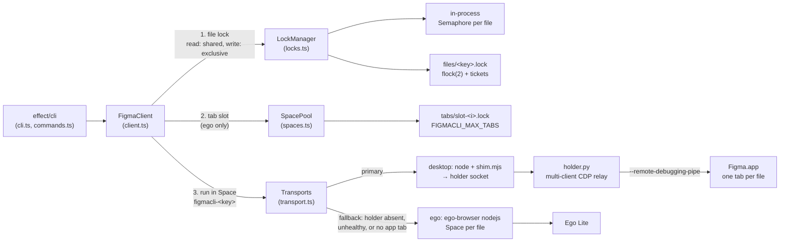

# figma-fast

A ground-up rebuild of `figmacli` 0.1.0 (sitecli `cmd/figmacli`) in TypeScript on Effect 4, run and compiled by Bun.
It keeps figmacli's commands, flags, output and `-yes` safety, and drops the one global lock that made every
run, on any file, wait for every other run.

Local only. Nothing here has been pushed or published; it waits for review.

## Why

figmacli 0.1.0 put every run in one Ego Lite Space, `figmacli`, with one tab, and made every run take one
global lock, reads included, because a read on file B would move the tab away from a write on file A. Two
agents on two files waited for each other for up to 20 minutes.

figma-fast gives every file its own Space and its own lock:

- Different files run at once.
- Reads of one file run together.
- A write has its file to itself.

## Architecture



A run takes three steps, in this order:

1. **The file's lock** (`LockManager`). There are two tiers.
   - **In one process:** each file key has a `Semaphore`. A read takes one permit and a write takes all of
     them, so fibers queue without polling.
   - **Across processes:** each file has a lock file, `files/<key>.lock`, held with `flock(2)` (shared for a
     read, exclusive for a write) through `bun:ffi`. The kernel drops the lock when its process dies, however
     it dies, so a crash never blocks a file.
   - Next to each lock, `files/<key>.tickets/` holds one JSON ticket per waiting or holding run. Tickets name
     the holder when a wait times out, and a reader lets an older waiting writer go first. A ticket whose
     process is dead is deleted on sight, which is how stale holders are detected.
2. **A tab slot** (`SpacePool`), taken only when the transport opens browser tabs (ego). A run holds one of
   `FIGMACLI_MAX_TABS` slot files, `tabs/slot-<i>.lock`, with `flock`, so the cap holds across every process.
   The file lock is taken first, so a run never holds a scarce slot while it waits for its file.
3. **The run**, in Space `figmacli-<key>`, through the first transport that can take it (`Transports`).
   - `desktop` is primary. It runs when `FIGMACLI_TRANSPORT=auto` (the default) and the holder answers a
     `Browser.getVersion` call within 1 s.
   - `ego` is the fallback. The client moves on only on `TransportUnavailable` or `NoDesktopTab`, the two
     errors that prove nothing ran in a page, so a write can never run twice.

Shared reads and Spaces:

- A read of a file whose Space is cold (never opened, or closed by the reaper) takes the write lock, so two
  reads never race to open the tab.
- The page script closes a Space's extra pages only on an exclusive run (`INPUT.exclusive`). That is the only
  change to `figma.mjs`.

Errors are tagged (`Data.TaggedError`) and set the exit code:

- **2** for `BadInput` (a wrong invocation or spec).
- **1** for `Findings` (check found something), with the report kept on stdout.
- **1** for everything else, as an `error: …` line.

### Modules

| Module | Role |
|---|---|
| `src/domain.ts` | The shared data shape: `FileKey`, `Access`, `Request` (the page script's `INPUT`), `Ticket`, the tagged errors |
| `src/config.ts` | `FigmaConfig` service, read through Effect `Config` |
| `src/flock.ts` | `flock(2)` through `bun:ffi` (`libSystem.B.dylib` on macOS, `libc.so.6` on Linux) |
| `src/locks.ts` | `LockManager`: the per-file RW lock |
| `src/spaces.ts` | `SpacePool`: Space names, tab slots, last-used stamps |
| `src/transport.ts` | `Transports`: desktop, ego, health probe, order |
| `src/client.ts` | `FigmaClient`: lock, then slot, then run, then decode |
| `src/specs.ts`, `src/tokens.ts` | Schema shapes and the checks of figmacli's `spec.go` and `tokens.go` |
| `src/commands.ts`, `src/cli.ts`, `src/main.ts` | Commands, effect/cli wiring, and the entry point |
| `src/reaper.ts` | Closes Spaces left idle |
| `assets/figma.mjs`, `assets/shim.mjs` | figmacli's page script and desktop shim, embedded as text |
| `holder/holder.py` | The multi-client CDP holder |

### The holder

`holder/holder.py` replaces the single-client holder from `agent-skills/skills/comms-figma/scripts/`. The old
holder sent replies to the newest client only, so a new connection, a health probe included, took over and
silenced the run in flight. The new holder serves many clients:

- **Ids:** each call's id is rewritten to one of the holder's own (kept under 2^31, which is all Chromium
  reads). The reply goes back to the client that sent the call, with that client's id restored.
- **Sessions:** a session made by `Target.attachToTarget` belongs to the client that asked. Events on that
  session go to that client only. Events with no session go to every client.
- **Leaving:** when a client disconnects, the holder detaches that client's sessions.
- **Tabs:** it never opens or closes a tab, so the Figma app keeps one tab per file, its user's.

The holder stays in Python, standard library only, for three reasons:

- The Mac already runs this pipe setup in Python: real `os.pipe` fds moved to 3 and 4 with `pass_fds`, which
  is what `--remote-debugging-pipe` reads. Node and Bun hand a child socketpairs instead, and I could not test
  Chromium against those here.
- It is a long-lived daemon. As Python, it needs no Bun runtime and no 90 MB binary.
- The change is a diff against the script already in use, so it is easy to review.

## Settings

| Setting | Default | |
|---|---|---|
| `FIGMACLI_TRANSPORT` | `auto` | `desktop`, `ego`, or `auto` (desktop first when the holder answers, ego after it). Kept |
| `FIGMACLI_DESKTOP_SOCKET` | `~/.cache/figma-cdp/cdp.sock` | The holder's socket; `holder.py` reads it too. Kept |
| `FIGMACLI_QUEUE_DIR` | `~/Library/Caches/figmacli` (macOS) | Lock files, tickets, tab slots and stamps. Kept |
| `FIGMACLI_LOCK_WAIT` | `20m` | Go duration. How long a run waits for its file lock, then for a tab slot. Kept |
| `EGO_BROWSER` | `ego-browser` | The ego-browser command, which may carry arguments (`ssh mac ego-browser`). Kept |
| `FIGMACLI_MAX_TABS` | `3` | New. Runs that drive a browser tab at once, across all processes; `0` means no cap |
| `FIGMACLI_LOCK_POLL` | `250ms` | New. How often a run waiting on another process checks again |
| `FIGMACLI_IDLE_CLOSE` | `10m` | New. How long an idle Space stays open before the reaper closes it |
| `FIGMACLI_RUN_TIMEOUT` | `6m` | New. The limit on one transport run (the 6-minute push limit). An eval gets its `-timeout` plus 1 m |
| `FIGMACLI_EGO_SERVER_NAME` | empty | New. Passed as `--ego-server-name=<name>` before `nodejs` |
| `FIGMACLI_NODE` | `node` | New. The program the desktop transport runs the page script with |
| `FIGMACLI_REAPER` | `on` | New. `off` starts no idle reaper (CI, tests) |
| `FIGMA_HOLDER_APP` | `/Applications/Figma.app/Contents/MacOS/Figma` | New, read by `holder.py` |

## Use

```sh
bun install
bun src/main.ts doctor                # run from source
bun run build                         # dist/figma-fast-darwin-arm64
bun run test                          # vitest on Bun, threads pool
bun run typecheck                     # tsc 7, strict
```

The commands are the same as figmacli's: `file`, `pages`, `read`, `write`, `tokens`, `arrange`, `label`,
`swap`, `grid`, `check`, `export`, `eval`, `rename` and `doctor`. Single-dash flags still work (`-yes`,
`-page Mockups`, `-timeout=90s`), because they are rewritten to effect/cli's double-dash form before parsing.

## Migrating from figmacli 0.1.0

1. **Build and install.** Run `bun run build`, then copy `dist/figma-fast-darwin-arm64` to `~/.local/bin/figma-fast`.
   To keep scripts unchanged, also link it as `figmacli`.
2. **Replace the holder.** Stop the old `holder.py`, then start `holder/holder.py` in its place. The socket path
   and launch are the same. Do this before relying on `auto`: with the old holder, the health probe takes over
   the single client slot and cuts off a run in flight.
3. **Running old and new side by side** is safe for tabs but not for writes:
   - Tabs: figmacli uses Space `figmacli`, and figma-fast uses `figmacli-<key>`, so the two never move each
     other's tab.
   - Writes: they share `FIGMACLI_QUEUE_DIR`, but figmacli's `lock`/`tickets` and figma-fast's
     `files/`/`tabs/` are separate, so they do not lock against each other. Do not write to the same file
     from both at once.
4. **Close the old Space.** The old shared Space `figmacli` stays until figmacli's reaper closes it. figma-fast
   runs only `doctor` there.
5. **Expect these output changes:**
   - `doctor` adds `max_tabs` and a `locks` table, and `space` reads `figmacli-<file key>, one per file`.
   - `--help` for a command is effect/cli's text, not figmacli's TOON. The top help is still TOON.
   - A usage error from effect/cli (an unknown flag) prints effect/cli's report, with exit code 2.

## Not done yet

- **Commands:** all 14 are ported, none left out. `tokens` compiles exactly as the Go compiler does (a test
  compares it with `test/fixtures/tokens.expected.json`, made by Go). The other commands' output and the spec
  checks were ported by reading the Go code; their tests cover a few cases each, not every message.
- **No live run.** Nothing was run against a real Figma app, a real holder on a Mac, or Ego Lite. The
  transports are tested with a fake app behind the real holder and a fake ego-browser.
- **Writer fairness in one process:** the in-process `Semaphore` does not let a waiting write go before later
  reads. Across processes, the tickets do.
- **The `--ego-server-name` position** before `nodejs` is a guess from the flag's name. Check it with
  `ego-browser --help` on the Mac.
- **The reaper** closes only through the first transport. A Space that was opened by an ego fallback while
  desktop is first stays open until ego is first again.
- **Go's JSON decoder matched field names case-insensitively.** Schema is exact, so `"Page"` is now an unknown
  field.
- **Tests run under Bun only.** `flock` comes from `bun:ffi`, so `vitest` under Node cannot load the lock module.
